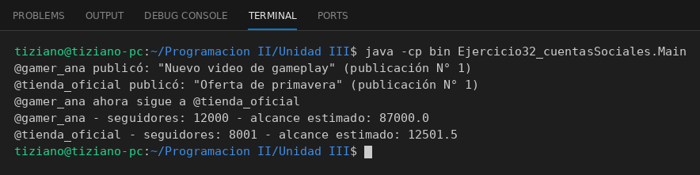

# CuentaSocial

Programación II - Unidad 3 - Ejercicio 32

## Consigna
Modelar una jerarquía de clases con herencia: una clase base y subclases que reutilizan código con `super` y sobrescriben métodos. Cuentas de una red social.

## Lógica
- `CuentaSocial` con `publicar`, `seguir` y `calcularAlcance()`.
- `CuentaCreador` suma visualizaciones; `CuentaCorporativa` suma administradores.
- `Main` simula publicaciones y muestra el alcance de cada cuenta.

## Ejecución

